# Stereo Vision 3D Reconstruction and Point-Cloud Merging

Stereo vision enables three-dimensional scene reconstruction by estimating depth from corresponding points in two images. This project aims to implement a stereo vision pipeline and investigate factors affecting reconstruction quality, including camera calibration, stereo matching, and scene conditions. 
Two stereo setups are implemented and trialed: a dedicated binocular stereo camera, and a single phone camera setup.

## Theory of Stereo Camera Reconstruction

### Calibration
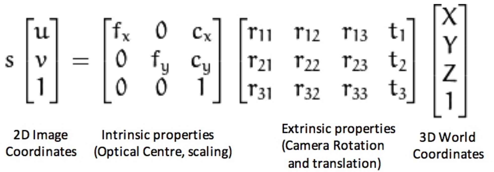

For calibration, the checkerboard grid is used to represent the 3D world coordinate points, which are matched to 2D image pixels in the taken photo. An algorithm is used to extract the intrinsic parameters like optical centre and focal length, and extrinsic parameters like relative translation and rotation between the two cameras.

### Reconstruction
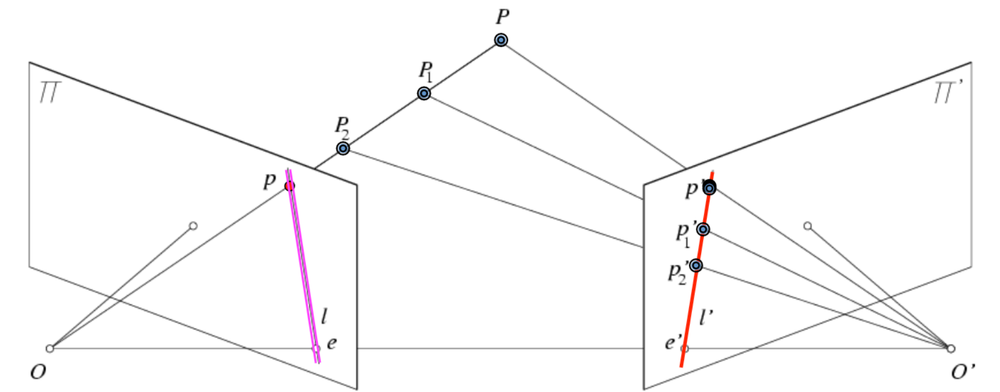

For reconstruction, when a 3D point appears in both camera views, any point in the first image must lie on an epipolar line in the second image. The calibration parameters are used to align epipolar lines to be horizontal. When a matching pair of points is found on corresponding epipolar lines, the horizontal shift between them is used to triangulate the depth of the point in 3D world.

## Calibration and Reconstruction Pipeline overview
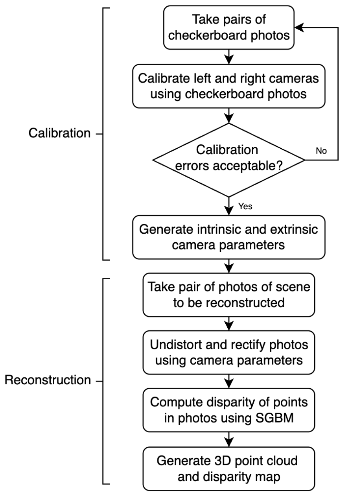

For the reconstruction program, Python code in Jupyter was used, including several camera-related functions from the cv2 library.

## Repository contents

The project evolved through several script and notebook versions. Use the version agreed on by the team for your experiment; names below reflect files used during development.

| File or directory | Purpose |
|---|---|
| `CameraCalibration.py` | Calibrates the stereo cameras from saved calibration image pairs. The exact input configuration depends on the version in use. |
| `Processing.ipynb` | Main interactive stereo reconstruction workflow. |
| `calibration_diagnostics.py` | Evaluates reprojection errors, checkerboard coverage, stereo-pose consistency, rectification quality, and potential outlier pairs. |
| `reconstruction_diagnostics.py` | Reports disparity coverage, valid depth, disparity/depth distributions, and optional left-right consistency. |
| `outputs_2/` | Example development output directory containing point clouds such as `shot*.ply` and the merged result. |
| `captured_pairs/` | Example location for saved left/right checkerboard calibration images. |
| `reconstruction_capture/` | Example location for saved raw, rectified, and diagnostic stereo scene images. |

## Setup

### Calibration
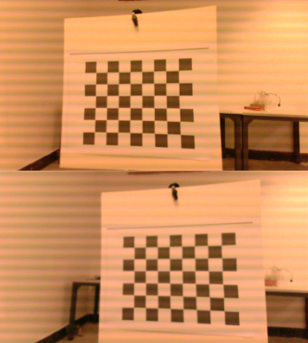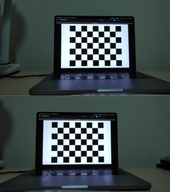

Calibration uses checkerboard images visible in both cameras. One development setup used a checkerboard square size of **23.2 mm**. Set the square size in the calibration code to the measured size of the physical board you actually use.

For reliable measurements:
- Keep the two cameras rigidly fixed relative to one another.
- Lock focus and, where possible, exposure, gain, white balance, and resolution before collecting calibration images.
- Capture the checkerboard at varied positions across the image, not only around the centre.
- Include varied tilts in both axes and several distances, while keeping the entire board sharp and visible in both cameras.
- Capture scene images with both cameras synchronised and at the same resolution used for calibration.


### Binocular Stereo Camera
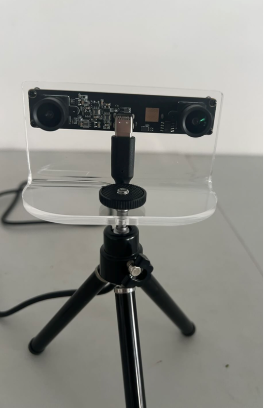

The main setup uses a fixed binocular USB camera with two lenses and a nominal horizontal baseline of approximately **65 mm**. The two views are captured at the same time, which helps preserve the relative camera pose required for stereo reconstruction.


### Single Phone Camera
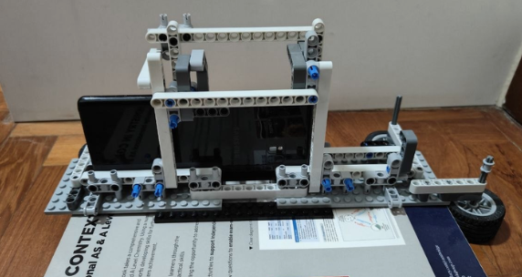

For the phone camera setup, a rig was built to hold the phone upright, and only allow it to move a fixed distance left and right to take the two stereo images, while locking it in the up-down and forward-backward directions. This ensures that the two camera views have a consistent fixed translation and rotation relative to each other throughout the checkerboard calibration and scene reconstruction photos. 


To take stereo image pairs, the scene and the rig are kept in fixed positions, and the phone camera settings are changed to manual to keep its intrinsic parameters constant. The phone is first aligned with the left limit of the rig, and the first photo is taken. The phone is then aligned with the right limit of the rig, and the second photo is taken. This allows a single phone camera to replicate the function of the binocular stereo camera taking both stereo images simultaneously.

## Installation

Use a dedicated Python environment. During development, mixing Conda's OpenCV package with the pip-installed `opencv-python` package caused version conflicts between scripts, so install OpenCV consistently within one environment.

If the repository contains a `requirements.txt` file, install its pinned dependencies in the active environment:

```bash
python -m venv .venv
source .venv/bin/activate       # macOS/Linux
# Windows PowerShell: .venv\Scripts\Activate.ps1

python -m pip install --upgrade pip
python -m pip install -r requirements.txt
```

The workflow uses OpenCV (`cv2`), NumPy, Jupyter for notebooks, and Open3D for point-cloud processing. If the dependency file does not include all packages required by the notebook you intend to run, install the missing packages in the same environment. Do not install both Conda and pip builds of OpenCV into one environment.

## How to use

### 1. Capture calibration pairs

Save each left image and its matching right image with a consistent pair identifier, for example:

```text
captured_pairs/
├── left/
│   ├── left_001.png
│   ├── left_002.png
│   └── ...
└── right/
    ├── right_001.png
    ├── right_002.png
    └── ...
```

Each left image must be paired with the right image taken at the same time and with the same checkerboard pose. Avoid blurred corners, glare, partial checkerboards, and repeated images with nearly identical poses.

Aim to include checkerboard centres near the **top-left, top-centre, top-right, middle-left, centre, middle-right, bottom-left, bottom-centre, and bottom-right** regions of the image. Bring the board closer for some captures so it occupies a larger portion of the frame, but keep the entire checkerboard visible in both images. Include different distances and tilts.

### 2. Run camera calibration

Configure the calibration script to use your saved image pairs and the correct checkerboard dimensions and square size. Then run the script from the repository root, for example:

```bash
python CameraCalibration.py
```

The script should estimate each camera's intrinsic matrix and lens-distortion coefficients, then estimate the stereo rotation and translation. Save the resulting calibration parameters and use the same calibration file for reconstruction.

**Important:** the translation scale depends on the units used for the checkerboard square size. If the square size is entered in millimetres, the estimated baseline and 3D coordinates will normally be in millimetres unless the pipeline explicitly converts them to metres.

### 3. Evaluate the calibration

Run the project's `calibration_diagnostics.py` helper through the calibration workflow, using the calibration observations and parameters generated by the script. The exact function call depends on the version of the code.

The diagnostic report evaluates several complementary properties:

- **Reprojection error:** how closely the estimated camera model projects checkerboard corners back to their observed image positions.
- **Checkerboard coverage:** the spread of board centres and the fraction of each image occupied by the board.
- **Stereo-pose consistency:** whether independent image pairs give similar estimates of the relationship between the cameras.
- **Rectification quality:** whether corresponding checkerboard points lie on nearly the same horizontal rows after rectification.
- **Outlier pairs:** images with unusually high left/right reprojection errors or poor rectified alignment.

The project's diagnostic thresholds use approximately **below 0.7 px** as a good per-camera RMS target and **below 1 px** for the 95th-percentile rectified vertical error. These are project targets rather than universal guarantees of metric accuracy. A low RMS alone is insufficient if the checkerboard barely moves across the image.

Typical diagnostic outputs include a readable calibration report, a per-pair error CSV, and a chart highlighting potential outliers. Review the flagged image pairs, remove genuinely poor captures where appropriate, and recalibrate.

### 4. Capture a scene for reconstruction

Save a synchronised left/right image pair of the scene. A useful folder structure is:

```text
reconstruction_capture/
├── raw_left.png
├── raw_right.png
├── raw_pair.png
├── rectified_left.png
├── rectified_right.png
├── rectified_pair.png
└── disparity_check.png
```

These intermediate images make it easier to diagnose problems. In `rectified_pair.png`, corresponding features should appear on the same horizontal rows. If they do not, check calibration, image pairing, camera movement, and rectification before tuning disparity parameters.

For the first reconstruction test, use a simple scene with well-separated objects, a visible background, good lighting, and textured matte surfaces. Avoid transparent objects, glossy reflections, featureless surfaces, severe occlusion, and objects too close to the cameras. Add texture to otherwise blank objects when practical.

### 5. Generate the disparity map and point cloud

Open the selected processing notebook (for example, `Processing.ipynb`) and run its cells in order. Confirm that it loads the intended calibration file and the correct raw stereo pair.

The reconstruction workflow generally:

1. Loads and rectifies the left/right images.
2. Computes disparity with OpenCV's SGBM matcher.
3. Reprojects disparity into 3D coordinates using the stereo reprojection matrix.
4. Filters invalid disparities and points outside the configured depth range.
5. Exports a coloured point cloud as a `.ply` file and saves diagnostic images.

Inspect the rectified pair and disparity map before judging the point cloud. Tune the valid-point mask and matcher settings carefully: aggressive filtering may reduce noise but also remove real surfaces, while loose filtering may retain false matches.

Disparities close to the configured maximum `numDisparities` can indicate incorrect matches. Do not assume every positive disparity is reliable. Where runtime permits, enable the independent left-right consistency check and keep matches whose forward and reverse disparities agree within the chosen tolerance.

### 6. Evaluate the reconstruction

Use `reconstruction_diagnostics.py` from the processing workflow. It evaluates whether the disparity and reconstructed geometry are internally plausible by reporting:

- **Positive-disparity coverage:** the fraction of pixels with a usable positive disparity.
- **Valid-depth coverage:** the fraction of points inside the configured physical depth range.
- **Disparity distribution:** median and percentile values, which can expose suspicious concentrations near the search limit.
- **Depth distribution:** median and percentile depths, which help reveal implausible or background-dominated results.
- **Optional left-right consistency:** whether the left and reverse stereo matches agree.

The project's reports use roughly **above 50% positive-disparity coverage** as good, **25–50%** as marginal, and **below 25%** as poor. These are practical heuristics, not universal pass/fail rules; textured surfaces and scene composition strongly affect coverage.

When exhaustive left-right consistency is disabled for speed, a positive-disparity mask is **not** an independent correspondence check. Keep that distinction in mind when interpreting the saved consistency image. These diagnostics assess internal plausibility, not absolute ground-truth accuracy.

### 7. Merge multiple point clouds (optional)

For a more complete view of a scene, capture point clouds from different viewpoints and merge them with Open3D. The development workflow loads `.ply` files from `outputs_2/`, downsamples them, removes isolated statistical outliers, estimates normals, and aligns successive clouds with point-to-plane Iterative Closest Point (ICP).

The example workflow used values around:

- `voxel_size = 0.008` for voxel downsampling.
- `icp_distance = 0.05` as the maximum correspondence distance.
- A fitness threshold of `0.35` and an inlier RMSE threshold of `0.035` to reject poor alignments.

These settings are starting points, not universal values. Their meaning depends on the coordinate units and scale of the input clouds. ICP is a local alignment method: starting with an identity transformation works best when the clouds already have substantial overlap and are roughly aligned. Symmetric or mostly planar scenes can lead to incorrect alignments even when the numerical fit looks plausible.

The example merge workflow saves:

```text
outputs_2/merged_pointcloud.ply
```

After merging, inspect the result for doubled surfaces, seams, ghosting, or detached clusters. High ICP fitness and low inlier RMSE are useful indicators, but do not by themselves prove that the merged scene is geometrically correct.

## Results

### Binocular USB camera
#### Calibration
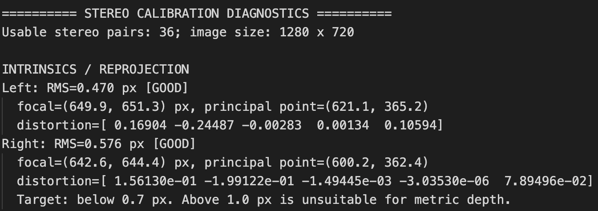

#### Reconstruction
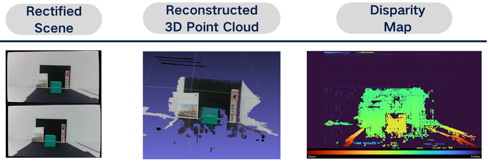

### Merged Point Clouds
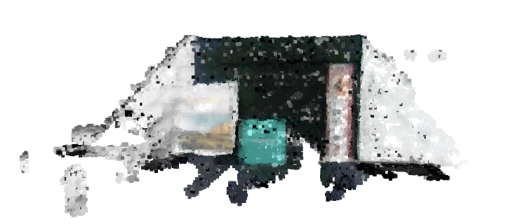

### Single Phone camera
#### Calibration
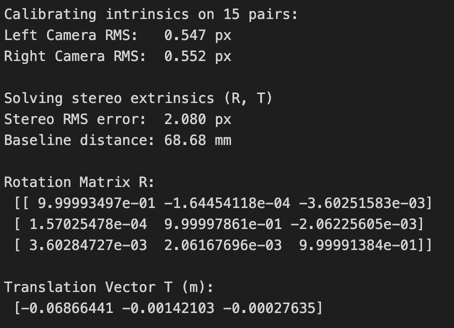

#### Reconstruction
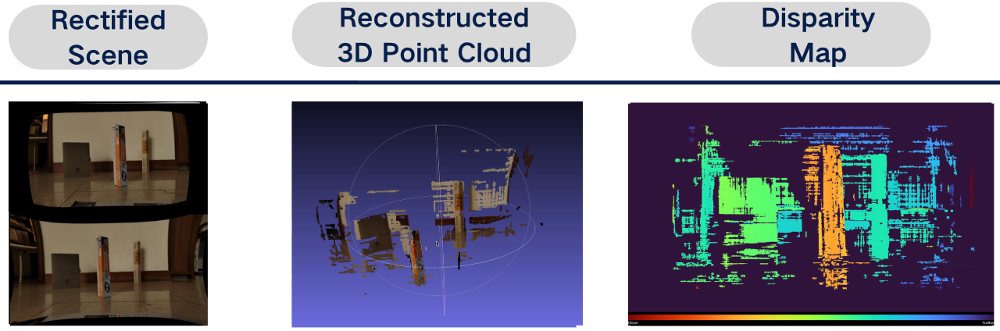

### Reconstruction and merging

A better reconstruction was obtained by using brighter, more consistent lighting, a matte background, and clearly textured objects with useful separation in depth. One reported result had a depth range of approximately **0.33–0.88 m**, with visible separation between the table foreground, objects, and backdrop. A later multi-view ICP workflow aligned several individual point clouds and saved a merged `.ply` file.

These examples demonstrate that capture conditions matter as much as the algorithm settings. They should not be interpreted as a formal accuracy benchmark without comparison against known ground-truth geometry.

## Troubleshooting

| Symptom | Possible cause | What to check |
|---|---|---|
| Low calibration RMS but poor reconstruction near image edges | Checkerboard positions are concentrated near the image centre | Capture calibration views across all edges and corners, with varied tilts and distances. |
| High left/right RMS | Blurred corners, poor lighting, incorrect checkerboard settings, or bad image pairs | Inspect detections and per-pair errors; retake or exclude poor pairs. |
| High stereo RMS despite reasonable individual-camera RMS | The relative camera pose is inconsistent between pairs, or the stereo image pairs are not truly synchronised | Keep the cameras rigidly fixed and use simultaneous left/right captures. A phone moved between shots is especially vulnerable. |
| Corresponding features are not horizontally aligned after rectification | Incorrect calibration, wrong image size, mismatched images, or camera movement | Confirm the calibration resolution and image pairing, then inspect the rectified pair. |
| Large streaks or detached point clusters | False disparity matches, reflective/textureless surfaces, or disparity values near the search limit | Improve texture and lighting, enable left-right consistency checking, and reject unreliable disparities. |
| Point cloud has holes | Low texture, occlusion, blur, transparency, or strict filtering | Improve scene texture and lighting, reduce occlusion, and relax filters only after checking for false matches. |
| Merged cloud contains doubled surfaces or is misaligned | Insufficient overlap or ICP converged to a local minimum | Capture views with substantial overlap; inspect each alignment and consider a better initial transformation. |
| Different scripts behave differently after installing OpenCV | Conflicting OpenCV packages or versions | Use a separate environment and install one OpenCV distribution consistently. |

## Limitations

- Stereo depth quality depends on image texture, lighting, camera synchronisation, calibration coverage, and the physical stability of the rig.
- Reprojection RMS and rectification diagnostics measure aspects of model fit; they do not independently establish absolute 3D accuracy.
- SGBM can produce incorrect matches on blank, repetitive, reflective, or transparent surfaces.
- Filtering improves visual cleanliness but can also remove valid geometry.
- ICP merging is sensitive to overlap, scene geometry, coordinate units, and the initial alignment.
- Results from the development captures should be revalidated when camera settings, resolution, baseline, or scene conditions change.

## Contributors

<a href="https://github.com/OWNER/REPO/graphs/contributors">
  
</a>